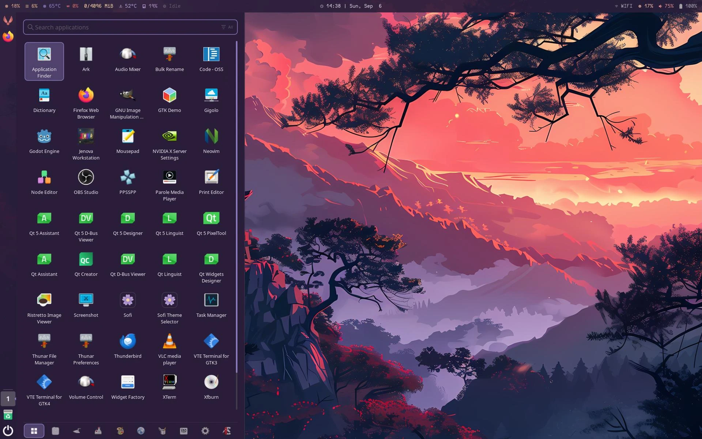

<h1 align="center">Saber</h1>
<p align="center"><i>The persistent vertical panel of the Hikari Sakura desktop — launcher, running indicators, quicklists, application menu, window spread, system tray and session controls, in one always-present column.</i></p>

<p align="center">
  <b>FreeBSD and Linux.</b> ·
  <a href="#building">Building</a> ·
  <a href="#configuration">Configuration</a> ·
  <a href="#making-the-keys-work">Keybindings</a> ·
  <a href="#troubleshooting">Troubleshooting</a> ·
  <a href="#known-limits">Known limits</a>
</p>

<p align="center">
  
</p>

---

> **Status: working, not yet released.** The panel runs, draws, and every planned surface
> exists. What is missing is listed under [Known limits](#known-limits) and is stated rather
> than left to be discovered.

## What Saber is

Saber is a vertical panel for Wayland in the tradition of the Unity 7 launcher, built for and
only for the [`hikari-sakura`](https://github.com/orpheus497/hikari-sakura) compositor. It
builds, links and runs on FreeBSD and on Linux — see [Building](#building).

Its reason to exist is that nothing else in the desktop is **persistent**. Every `sofi` surface
appears on a keypress or a click and dismisses on selection. A launcher in the Unity sense is a
different kind of object: always on screen, aimed at without looking, showing at a glance what
is running — and it is where the system tray lives.

It is a **pure Wayland client**. Windows are listed and acted on through
`wlr-foreign-toplevel-management`, surfaces are placed with `wlr-layer-shell`, and the
compositor's sheets are read over its own control socket. Nothing about the compositor is
patched, and Saber asks it for nothing it does not already publish. It draws itself with cairo
and pango rather than linking a widget toolkit.

## The Sakura set

Four programs, built to be used together, each usable on its own:

| | Program | Written in | Role |
|---|---|---|---|
| 1 | [**sakura**](https://github.com/orpheus497/sakura) | Zig | **Display manager.** A TUI login manager on a FreeBSD virtual terminal. Talks to OpenPAM directly; no toolkit, no session bus, no login-manager framework |
| 2 | [**hikari-sakura**](https://github.com/orpheus497/hikari-sakura) | C | **Compositor.** Stacking, with tiling; built on wlroots, and on *views*, *groups* and *sheets*. Draws its own top bar and lock screen |
| 3 | [**sofi**](https://github.com/orpheus497/sofi) | C | **Overlays.** Every surface that is summoned rather than always present — application menu, control panel, sheet switcher, volume and network panes, notification history — plus the notification daemon |
| 4 | **saber** — this repository | C | **Panel.** The one surface that is always present: launcher tiles, quicklists, the system tray and session controls, in a column that reserves its own space |

### How Saber fits

**The line is persistence, and it decides every case.** Saber is on screen for the whole session
and reserves an exclusive zone, so windows tile beside it. Every `sofi` surface is summoned, does
one job and dismisses. The two therefore do not compete for screen area even where they cover the
same subject — Saber's Dash is a *docked* application grid and `sofi -show drun` is a *summoned*
one, and running both is normal.

* **The compositor keeps all telemetry.** CPU, RAM, temperature, network, battery, volume,
  media and the clock live in `hikari-sakura`'s own top bar, fed by `hikari-topbar`. Saber
  duplicates none of it — a panel anchored to the left edge sits *underneath* that bar
  automatically, with nothing to configure and no height to keep in sync.
* **`sofi` keeps everything that is summoned**, and that is more than notifications. Besides
  `sofi -notification-daemon` and `sofi -show notification-history`, it owns the **control
  panel**, the **sheet switcher**, and the **volume** and **network** panes. Saber builds no
  volume, network or Bluetooth menu of its own and is not going to: the top bar *reports* those,
  `sofi` *changes* them, and a third implementation in the column would be the one place a user
  could set a value that the other two disagree with.
* **Saber takes the system tray, and this one is an either/or.** Exactly one process on a
  session bus can own `org.kde.StatusNotifierWatcher`. `sofi -tray-daemon` exists and draws no
  surface by default precisely because Saber owns the tray; run only one. See
  [Troubleshooting](#the-system-tray-is-empty).
* **The panel keeps its own space, and what each surface asks for is a layer and an exclusive
  zone.** Three surfaces of this set can be on screen at once. The panel column is on the
  layer-shell `TOP` layer and reserves its own width, so windows tile beside it and a fullscreen
  window covers it. The Dash and the spread are on `OVERLAY` and reserve nothing, so they draw
  *above* a fullscreen window — and every `sofi` surface is on `OVERLAY` reserving nothing as
  well. A surface that reserves nothing asks not to sit on top of one that does:
  `wlr-layer-shell-unstable-v1` says of a zero zone that *"the surface indicates that it would
  like to be moved to avoid occluding surfaces with a positive exclusive zone"*, and zero is the
  protocol's own default. That is a request to the compositor rather than a guarantee of the
  protocol, and it is what makes a `sofi` menu dock beside the column instead of over it on a
  compositor that honours it, without either program knowing the other exists. Between two
  surfaces that both reserve nothing the protocol says nothing at all, so a Dash and a `sofi`
  surface open at the same moment may overlap; nothing here prevents that, and nothing needs to,
  because both are summoned deliberately. The lock screen hides all of them.

**Saber triggers `sofi` by running it.** There is no `sofi` IPC socket and none is needed: each
surface is one invocation of the binary holding its own instance lock, so a launcher tile, a
`hikari.lua` keybinding and a shell script all reach it the same way, and pressing the same
trigger twice does not stack two copies. `sofi -show drun`, `-show window`, `-show sheets`,
`-show volume`, `-show network`, `-show notification-history`. Saber ships **no** binding for any
of them — the shipped `launcher.favourites` seeds `sofi.desktop`, which is the application
menu, and the rest are yours to bind in `hikari.lua` or pin. `org.sofi.Tray` is a private
interface between two `sofi` processes and is not a handoff surface; the commands are the
contract.

## The column

Top to bottom, each item switchable in `items`:

| Item | Left click | Middle click | Right click | Scroll |
|---|---|---|---|---|
| **BFB** (the winged orb) | Open the Dash | Open the Dash | Open the Dash | — |
| **Application tile** | Launch · focus · minimise if already focused · spread when 2+ windows | New instance | Quicklist | Cycle that app's windows |
| **Sheet** | Sheet grid | — | Sheet grid | Step sheet |
| **Device** | Open the mount point | Unmount | — | — |
| **Trash** | Open the trash | — | Open / Empty Trash | — |
| **Tray item** | Activate, or its menu | Secondary activate | Context menu | Forwarded |
| **Session** | Session menu | — | Session menu | — |

**When the launcher band runs out of room, it scrolls.** Everything listed before `apps` in
`items.order` is pinned to the top of the column and everything after it is anchored to the
bottom; the band takes the space left between them. A wheel anywhere on the column that is not
over a tile with a scroll of its own — the BFB, a device, the trash, the session tile, an
application with fewer than two windows, or the empty gap — moves the band instead. A small
chevron appears at whichever end has more beyond it, and **the chevrons are buttons**: clicking
one steps the band by a tile and deliberately does *not* activate the tile it is drawn over.

### Tile decoration

Each is a Unity signifier drawn from a [theme role](#theming), never a fixed colour:

| Signifier | Meaning |
|---|---|
| Pips, inner edge | 1 / 2 / 3+ open windows |
| Arrow, outer edge | This application holds focus |
| Backlight | The tile fill behind a running application |
| Count badge | `count` from `com.canonical.Unity.LauncherEntry` |
| Progress bar | `progress`, 0.0–1.0, from the same |
| Wiggle and red tint | `urgent` |
| Throb | Launching, until the window appears |

### Quicklists

Right-clicking an application composes its menu in this order: the application's **dynamic**
menu published over `com.canonical.dbusmenu` → its desktop entry's **static** `Actions=` → its
window list when there is more than one → Keep in launcher / Unpin → Quit.

Saber renders the menu itself. Under StatusNotifierItem and DBusMenu an application publishes a
*description* of a menu, and there is no method in either protocol that asks it to display
anything — rendering is the host's job, and that is exactly what lets the panel theme it.

### The Dash

`saberctl dash`, or click the BFB. A panel docked to the same edge as the column, full height and
one third of the output wide — held between 420 and 700 logical pixels, so a laptop still fits
three columns and an ultrawide is not handed half the desktop. The desktop beside it is left
undimmed. The search field is top-left; the category strip runs along the bottom.

Typing filters; categories filter; the two compose. Ranking puts prefix matches above interior
ones, across name, generic name and `Exec` basename. `Tab` cycles categories, arrows move and
scroll the grid, `Enter` launches, `Escape` dismisses — as does a click outside the panel.

### The window spread

`saberctl spread [app_id]`, or click a tile with two or more windows. A grid of every open
window — including windows living on sheets you are not currently looking at, which is the
whole point of it. `Enter` un-minimises and activates; `Delete` closes.

There are **no thumbnails**, and that is a design decision forced by the compositor. See
[Known limits](#known-limits).

## Theming

Saber has no theme file. It reads `ui.palette` straight out of your `hikari.lua`, so the
panel is painted from the same sixteen colours as the compositor, its top bar and its lock
screen. Drop a terminal colour scheme into `hikari.lua` and the whole desktop follows, panel
included.

`$XDG_CONFIG_HOME/hikari/hikari.lua` is read first, then `~/.config/hikari/hikari.lua`, then
`${ETC_PREFIX}/etc/hikari/hikari.lua`. The palette and the animation duration are the only two
blocks of that file Saber reads, and it writes neither back. The reader is deliberately tolerant
while the compositor's own Lua shape settles: the colours are taken from `ui.palette` or
from a top-level `palette`, the duration from `ui.animation` or a top-level `animation`, and
a missing, unparseable or unexpectedly shaped file costs nothing and falls through to the
built-in palette, which is `hikari-sakura`'s own Sakura. That last case is the ordinary first
run.

It is somebody else's file, read for two blocks, so it runs in the same restricted environment
as your own configuration — but deliberately not under the same strictness, because `hikari.lua`
may legitimately read globals Saber does not provide, and refusing the import over one of them
would fail a file the compositor itself accepts. See [Configuration](#configuration).
Keybindings are read by hikari out of its own `hikari.lua` — see
[Making the keys work](#making-the-keys-work).

Unity's mechanics are reproduced; Unity's Ambiance colours are not.

### The sixteen slots are positional, not semantic

`hikari-sakura` ships three palettes — Sakura, Sakura Dark and Sakura Light — and all three are
rendered correctly. They are positionally identical and semantically divergent: slot 1 is a red
on Sakura, a muted dark red on Sakura Dark and a muted **emerald green** on Sakura Light. A role
map pinned to slot numbers is therefore right for exactly one palette and paints urgency green
on another, which is why the eleven roles are *derived* from whatever palette is in force rather
than indexed out of it.

| Role | What it paints | Where it comes from |
|---|---|---|
| `background` | The column itself | `color0` |
| `foreground` | Pips, separators, text | `color15` |
| `accent` | Focus arrow, current sheet | whichever of `color12` and `color4` measures better against the background |
| `backlight` | The running-tile fill | the background, moved 45% of the way towards `accent` |
| `urgent` | Wiggle tint, urgent badge | a literal red chosen by the ground — the one exception, below |
| `badge_bg` | The count disc | follows `urgent` |
| `badge_fg` | The ink on the count disc | whichever of `color0` and `color15` measures better against `badge_bg` |
| `progress` | The progress overlay | follows `accent` |
| `hint` | Recessed content that is still read: the dash placeholder, its empty-state line, an unselected filter chip, the number of an empty sheet | the background, walked out towards `color6` until it reads 3.6:1 against the column |
| `dim` | Hairlines, frame outlines, tracks, a genuinely unavailable menu item | `color8` |
| `overlay` | Dash strip and spread backdrop | follows `background`, colour only — its alpha is `overlay-opacity` |

**`accent` and `badge_fg` are picked by measured contrast, not by a fixed slot**, which is what
makes them right for a palette Saber has never seen: your own, or the terminal colour scheme
dropped into `hikari.lua` that this page has already invited. On Sakura and Sakura Dark the
accent resolves to `color12`; on Sakura Light `color4` reads better against the light
ground — 4.97:1 against 3.32:1 — and is taken instead. Light or dark is measured from the
background's own WCAG relative luminance rather than configured, so an unfamiliar palette does
not have to declare which kind it is.

**`backlight` no longer shares `palette[8]` with `dim`.** It did, so a running application and
an unavailable action were painted in the same colour on every palette — and on two of the three
shipped ones that colour was invisible against the column: 1.34:1 on Sakura Dark, 1.16:1 on
Sakura Light. It is now a derived tone of the column itself and cannot collide with `dim` again.

**`hint` no longer shares it either**, which is the other half of the same defect. `dim` was
carrying two jobs with opposite requirements: the hairlines and outlines, which have to stay
quiet, and the content a user actually reads — "Search applications", "No matching
applications", an unselected filter chip, the number of an empty sheet — which has to stay
legible. On `palette[8]` that content measured 2.29:1, 1.34:1 and 1.16:1 against the three
shipped grounds, so on two of the three themes the sheet numbers and the dash placeholder were
not there. `hint` is *settled at* 3.6:1 rather than lifted above it: a placeholder that outreads
the labels around it has stopped being a placeholder, and taking `color6` outright would do
exactly that on the default palette, where it measures 5.97:1. It resolves to `#7c7986`,
`#6f6f74` and `#6a6d74` on the three palettes — the same figure, and the same walk, sofi settles
its own `hint` at, so a placeholder in the dash and one in a sofi panel recede together. `dim`
keeps `color8` and keeps the structural work, including the one thing in its list that genuinely
has no contrast floor: WCAG 2.1 exempts the text of an inactive component, which is what a
greyed-out menu item is.

### Urgency is the one colour the palette does not control

Every other role comes from your palette. `urgent` — and the `badge_bg` that follows it — is a
literal red, chosen by whether the ground is light or dark:

```
dark ground   #df8787          light ground   #9b2226
```

The reason is arithmetic rather than taste. No single red clears WCAG AA against both Sakura
Dark's ground and Sakura Light's, because the two required luminance windows do not intersect,
so one literal would be a choice of which theme to fail on. On Sakura it resolves to `#df8787`,
which is byte-identical to that palette's own `color9` and is what urgency already was there, so
the default desktop is unchanged by the split. Both literals are overridable, and
`theme.roles.urgent = "color9"` is how urgency goes back under a palette's control.

### Overriding a role

`theme.roles` overrides all eleven by name. Each takes either a palette reference
(`"colorN"`, or `"@colorN"` if you are coming from a sofi layout) or a literal (`"#rgb"`,
`"#rrggbb"`, `"#rrggbbaa"`), and what you write wins over the computed value:

```lua
theme = {
  roles = {
    accent = "color13",  -- a palette slot
    urgent = "#b03030",  -- or a literal
  },
},
```

**A slot reference resolves when the theme is built, not when the file is read**, so an override
still follows a palette that arrives from `hikari.lua` afterwards: `accent = "color13"` keeps
tracking a retheme exactly as the rest of the panel does. Derived roles follow what they derive
from — re-point `accent` and the backlight and the progress bar move with it, re-point `urgent`
and the count disc goes too, with the badge ink re-measured against whatever the disc ended up
being. All eleven are overridable, derived or not, so no colour the panel paints with is out of
reach.

Every colour decision above is held by `make test`, because every colour defect this panel has
had was found by measurement and nothing but a measurement keeps it fixed. One shortfall is
accepted rather than fixed, and it is stated under [Known limits](#known-limits).

## Configuration

`~/.config/saber/saber.lua`, in Lua: a chunk that **returns a table**, which is the language the
compositor's own configuration is moving to, so one syntax covers the desktop. **Every key is
optional and the whole file may be deleted**; the values below are the defaults. A copy with all
of this documented in place is installed at `${ETC_PREFIX}/etc/saber/settings.lua`, and it is the
fullest reference in the tree for what each key does.

**The file named after the program is yours; `settings.lua` is the one that shipped.** That rule
holds across the desktop — `saber.lua`, `sofi.lua` and `hikari.lua` are all files you write, and
each component reads its distributor's defaults from a `settings.lua` beside them. It is worth
stating because the two used to share a name and differ only by which directory they sat in, so a
path had to be read to its last component before it said whose file it was. An install predating
the rename still has `${ETC_PREFIX}/etc/saber/saber.lua`; it is read when `settings.lua` is
absent, and saber says so once on startup.

Four things hold for the whole file:

* **Either key spelling works.** The manual writes `icon-size`, `animation-ms` and
  `overlay-opacity`, and Lua can only write a hyphenated key as `["icon-size"]`, so the
  underscored spelling answers to the same key. `icon_size = 32` and `["icon-size"] = 32` are one
  setting, not two, and a file mixing the two reads both. The keys and their meanings did not
  change when the format did.
* **It is code, and it is sandboxed.** The chunk runs with `math`, `string`, `table` and a
  handful of basic functions — `assert`, `error`, `ipairs`, `pairs`, `select`, `tonumber`,
  `tostring`, `type` — installed in place of Lua's own globals, and with no `io`, no `os`, no
  `package`, no `require`, no `load` and no `dofile`. A panel's settings have no reason to open a
  file or start a process. This is deliberately stricter than awesome or neovim, which hand their
  configurations the whole language.
* **An unquoted word is refused, not quietly dropped.** Every value in the format this replaced
  was a bare word — `edge = left`, `autohide = never`, `backlight = palette`,
  `urgent = color9` — and all four are valid Lua reading an undefined global. Each would
  evaluate to `nil`, so the key would be absent rather than wrong and the setting would vanish
  while the file loaded without complaint: precisely the keys a hand migration is trying to carry
  over, lost in silence. So reading a name the environment does not hold is an error, reported at
  the line the word is on — `left is not defined; a word used as a value needs quoting, as in
  "left"`. `math` and `string` stay reachable, so a computed configuration still loads.
* **A file that will not parse is refused, not partly applied.** A syntax error, a chunk that
  does not finish, and a chunk that returns anything other than a table are all refused whole:
  Saber reports it with the line number Lua gives, and `reload` keeps the settings the panel is
  already running with. The instruction budget behind the second one sits three orders of
  magnitude above what the shipped file needs, so the only thing it can reject is a loop that was
  never going to terminate. A typo cannot cost you a configured panel.

```lua
return {
  panel = {
    output          = "all",     -- all | primary | <output name, e.g. eDP-1>
    edge            = "left",    -- left | right
    icon_size       = 32,        -- 24-64
    padding         = 12,        -- 0-64; column width is icon_size + padding, so 32+12 = 44px
    autohide        = "never",   -- never | auto  -- see the note below
    reveal_pressure = 240,       -- push distance to reveal an autohidden panel

    -- Commented out on purpose: writing this key at all takes the decision off
    -- the compositor. See the note below.
    -- animation_ms = 180,
  },

  theme = {
    inherit_hikari  = true,      -- import ui.palette and ui.animation from hikari.lua
    backlight       = "palette", -- palette | dominant | off  -- see the note below
    opacity         = 0.92,      -- the column itself
    overlay_opacity = 1.00,      -- dash strip and spread backdrop; 1.0 = opaque

    -- Optional. Overrides the hikari import; all sixteen must be present or the
    -- whole block is reported and ignored and the built-in palette is used.
    -- palette = { color0 = "#2b1e3a", ... color15 = "#f0edf2" },

    -- Optional. Overrides any of the eleven derived roles by name; see Theming.
    -- roles = { accent = "color12", urgent = "#df8787" },
  },

  launcher = {
    -- No default. Omit this and the launcher starts with running windows only.
    favourites = { "sofi.desktop", "firefox.desktop" },
  },

  items = {
    -- Top-to-bottom order of the column. "apps" is the launcher band and its
    -- position is the split: everything before it is pinned to the top,
    -- everything after it to the bottom. Unknown names warn and are ignored;
    -- duplicates count once; omitting "apps" reinserts it after "bfb".
    order = { "bfb", "apps", "sheets", "devices", "trash", "tray", "session" },

    -- The older per-portion form, still honoured, and a filter over the order
    -- above: false removes that portion wherever it sits, while true does not
    -- add one the order leaves out. There is no key for "apps".
    -- bfb = true, sheets = true, devices = true,
    -- trash = true, tray = true, session = true,
  },

  session = {
    -- Empty = use the built-in command: the operator-group command on FreeBSD,
    -- logind on Linux. See Session controls.
    suspend = "", reboot = "", poweroff = "",

    -- Empty = use the built-in on Linux, where logind supplies both; on FreeBSD
    -- it HIDES the entry, because there is nothing to run. See Known limits.
    lock = "", logout = "",
  },
}
```

`icon-size` 32 and 48 are sizes every icon theme ships natively; values between them make
raster icons resample, which is visible on a surface that is on screen permanently. `padding`
raises the tile pitch as well as the column width, so a larger value fits fewer tiles.

Five of these need a word on how they behave:

* **`autohide = auto`** hides the column and reserves nothing. A hidden column draws nothing and
  accepts pointer input only in a two-pixel strip at the screen edge, so the windows behind it
  are reachable through the space it would otherwise occupy. Push into that strip and it comes
  back; move off it and it goes away again.
* **`reveal-pressure`** is how far the pointer must travel *inside* that strip before the column
  reveals — distance, not dwell, so a pointer parked at the edge by accident never opens it and
  one deliberately rubbed against the edge does. Lower it if revealing feels stiff.
* **`animation-ms`** governs every animation, and that now includes the ones it used to miss.
  Autohide is animated, with the exclusive zone committed at the two ends of the slide rather
  than tracked through it — a zone following the offset would hand the compositor a half-width
  column to lay the desktop out against on every frame, and every window on the output would
  reflow to each one. Every reveal is symmetric: the Dash, the spread and the quicklist slid in
  and snapped out, and now they leave the way they arrived. The hover fade uses the value as
  written; the Dash's slide, the spread's fade-and-rise, menus fading up, the launcher band's
  scroll, the launch throb and the urgent wiggle are all scaled from it against a 180 ms
  baseline, so `0` genuinely stops all of them rather than leaving two of them running.
* **`animation-ms`, left unwritten, is inherited from the compositor.** While
  `theme.inherit_hikari` is on, hikari's own `ui.animation.duration` answers it — with
  `enabled = false` arriving as 0, which is the same statement made the other way round — and an
  explicit `panel.animation_ms` always wins over it. The consequence is worth stating plainly:
  `hikari-sakura` ships animation **off**, so on a stock desktop with no explicit setting the
  panel's motion is off too and every surface settles instantly. The installed `settings.lua`
  therefore leaves the key commented out, so copying the shipped file behaves exactly like having
  no file at all; write it to keep the panel moving while the compositor does not.
  `easing` is deliberately not imported — the panel picks a curve per animation, and a
  window-motion curve is the wrong one for a hover fade.
* **`backlight = dominant`** tints the running-application backlight to the icon's own colour
  rather than the palette's, sampled with a bias toward the saturated pixels so a mostly-grey
  icon with one coloured mark does not wash out. An icon carrying no colour at all falls back to
  `palette`.

### Favourites are stored twice, on purpose

`launcher.favourites` **seeds** the launcher on first run. The live order — the one you get
by dragging tiles — is kept in `$XDG_DATA_HOME/saber/favourites` and wins from then on. Saber
never rewrites your configuration file. Delete the state file to re-seed from it.

## Running it

Saber is resident, so it belongs in the compositor's autostart rather than on a key:

```sh
echo 'saber &' >> ~/.config/hikari/autostart
chmod +x ~/.config/hikari/autostart
```

Starting it there also removes a caveat the tray would otherwise have. A tray application asks
exactly once, at its own startup, whether a host exists; one that finds none shows no icon and
never asks again. A panel already running when your session starts is never the process that
arrives too late.

## Making the keys work

Saber is a layer-shell client, and a layer-shell client **cannot grab global keys** — there is no
protocol for it. Every keyboard shortcut therefore has to be a `hikari.lua` binding that runs
`saberctl`.

**Which file that is depends on which hikari-sakura you are running.** `hikari.lua` arrives with
hikari-sakura's own Lua migration; until that lands, `master` still ships `etc/hikari/hikari.conf`
and reads that. The three bindings below are already in place either way — `master`'s
`hikari.conf` defines the same `dash`, `spread` and `panel` actions over `saberctl` and binds
`LS+d`, `LS+e` and `LS+p` to them — so nothing in that table depends on the migration. What does
depend on it is the syntax of the entries further down, which are Lua tables: on `hikari.conf`
they go in that file's own syntax instead, as hikari(1) documents it.

**Three already ship.** hikari-sakura's own shipped configuration binds them, so on a stock
configuration there is nothing to do for these:

| Key | Action | Runs |
|---|---|---|
| `Logo`+`Shift`+`d` | `action-dash` | `saberctl dash` |
| `Logo`+`Shift`+`e` | `action-spread` | `saberctl spread` |
| `Logo`+`Shift`+`p` | `action-panel` | `saberctl toggle` |

They are the shifted counterparts of the `sofi` keys, so the pair stays on one map: unshifted
summons a `sofi` surface, shifted drives the panel that is already on screen.

**What does not ship, and needs adding by hand,** is `saberctl launch N` and the hold-Super number
overlay. The overlay is the one that cannot work without you: it needs a binding on the **press**
and another on the **release** of the same key, and no such pair is shipped.

`hikari.lua` is one Lua table — a single `return { ... }` — so these are **entries added to the
`actions` and `bindings.keyboard` tables it already has**, not blocks appended to the file. Pasting
a second `actions = { ... }` alongside the first does not merge the two: Lua keeps only the last
assignment to a key and discards the earlier table whole, silently, which is the one mistake to
avoid here.

```lua
actions = {
  -- ... the entries already there ...
  ["saber-1"]        = "saberctl launch 1",
  ["saber-2"]        = "saberctl launch 2",
  ["saber-3"]        = "saberctl launch 3",
  ["saber-numbers"]  = "saberctl overlay on",
  ["saber-nonumber"] = "saberctl overlay off",
},

bindings = {
  keyboard = {
    -- ... the bindings already there ...
    ["LA+1"] = "action-saber-1",
    ["LA+2"] = "action-saber-2",
    ["LA+3"] = "action-saber-3",

    ["L+Alt_L"] = {
      begin   = "action-saber-numbers",
      ["end"] = "action-saber-nonumber",
    },
  },
},
```

A hyphen cannot appear in a bare Lua identifier, so every name above is written in the
`["..."]` form — and `end` is a Lua keyword, which makes it the one key in the pair that *must* be
quoted. An action is named from a binding by its own name prefixed with `action-`, as a string:
`["LA+1"] = "action-saber-1"` runs `actions["saber-1"]`.

The overlay is the `begin`/`end` form: hikari guarantees a `begin` is always followed by its
`end`, so the numbers cannot be left on screen. `end` also fires when a further key goes down,
which is what you want here — pressing `1` launches the favourite and takes the legend away with
it. Hold whichever key the launch bindings sit under; with `LA+N` above, that is Logo held while
Alt goes down.

> **Why `Logo+Alt` and not `Super+N`.** The shipped `hikari.lua` is densely bound: `L+1`…`L+9`
> are `workspace-switch-to-sheet-N` and `LS+1`…`LS+9` are `view-pin-to-sheet-N`, so both of the
> obvious choices are taken — as are almost all of `L+`, `LS+` and `LC+`. `LA+` has very few
> bindings and is the free space. Hikari keeps only the **first** binding it reads for a key
> and reports the one it dropped at startup, so a collision fails quietly at the keyboard but
> loudly in the log.
>
> Unity's literal Super+N is therefore only available by giving up sheet switching on those
> keys. That is a real trade and yours to make; nothing here makes it for you.

### `saberctl`

```
saberctl dash                  toggle the application grid
saberctl spread [app_id]       toggle the window spread, optionally filtered
saberctl launch <1-10>         launch or focus favourite N
saberctl overlay <on|off>      the hold-Super number overlay
saberctl show | hide | toggle  panel visibility
saberctl sheet <0-9>           switch to sheet N
saberctl pin <0-9>             send the focused window to sheet N
saberctl reload                re-read the configuration
saberctl status                report panel state, terminated by END
saberctl quit                  exit the panel
```

It exits 0 when the panel answers `ok` and 1 otherwise, so it composes in scripts. It speaks to
`$XDG_RUNTIME_DIR/saber.sock`, which is also the single-instance lock: a second `saber` refuses
to start rather than stealing the socket, and a stale socket left by an unclean exit is removed
rather than being mistaken for a live panel.

`saberctl` links **only libc** — 14 KB on FreeBSD, 16 KB on Linux. That is deliberate: it runs
on every bound keypress, and linking the desktop's shared libraries to print one line would be
paid per keystroke.

## Session controls

Suspend, reboot and shut down — and, on Linux, lock and log out — all run as you. **Saber
installs nothing setuid or setgid, writes no `sudoers` rule, creates no group of its own and
writes no polkit rule either.** There is one interface with a backend per platform; the one that
does not apply compiles to an empty translation unit rather than a platform test in the build.

Saber asks at startup whether it can carry out each action and **hides** the ones it cannot, so a
host that declines leaves a menu with no dead buttons rather than one with failing ones. A
`session` command override is trusted without asking the platform anything, and is the whole
answer on a host with neither privilege model.

### FreeBSD: the `operator` group

Suspend, reboot and shut down go through FreeBSD's existing `operator` group:

```
-r-sr-xr--  root operator   /sbin/shutdown      setuid root, group-executable by operator
crw-rw-r--  root operator   /dev/acpi           group-writable by operator
```

A member of `operator` runs `shutdown -p now`, `shutdown -r now` and `acpiconf -s3` with no
escalation at all. If you are not in that group, an administrator runs:

```sh
pw groupmod operator -m <user>
```

`make install` prints this line when it applies; it never runs it, because adding a user to a
privileged group is an administrator's decision. Saber checks its own membership at startup, so
declining costs the three entries and nothing else. `session` overrides the commands for a
host that deliberately keeps its users out of `operator`.

`/sbin/reboot` is never used — it is not setuid, so it would fail. `shutdown -r now` is.

### Linux: logind

`Suspend`, `Reboot` and `PowerOff` on `org.freedesktop.login1.Manager`, called over the system
bus with the interactive flag set, plus the `Lock` and `Logout` that FreeBSD cannot offer at
all — `org.freedesktop.login1.Session.Lock` and `Manager.TerminateSession`. The interface is
spoken rather than linked, so systemd-logind and elogind are both answered and neither is a
dependency, and it needs no library the panel does not already link for its tray: GDBus, out of
glib.

The *connection* is its own, and the distinction matters. The tray's is on the session bus;
this one is on the system bus, so they are two connections and not one. Only this one has
`exit-on-close` disclaimed, because GLib documents the connection `g_bus_get_sync` returns as a
singleton that "will (usually) have the #GDBusConnection:exit-on-close property set to %TRUE",
and that property as "whether the process will be terminated (by calling `raise(SIGTERM)`) if
the connection is closed by the remote peer" — so a system `dbus-daemon` restart would otherwise
kill the panel outright, for the sake of a probe behind a menu nobody may have opened. The
session bus keeps the default, where quitting with the session is the correct behaviour and is
what the tray relies on.

Availability is logind's own answer: `CanSuspend`, `CanReboot` and `CanPowerOff`, where **both
`"yes"` and `"challenge"` count as available.** `"challenge"` is polkit saying it will prompt,
which is exactly why the interactive flag is set rather than clear — clearing it would have the
call refused outright on the machines where the probe said the action works. The probes are
synchronous and run with a menu half-open in front of you, so they carry a 300 ms timeout: a
wedged bus is a stutter rather than a freeze.

There is no group to join here and nothing for an administrator to do. Each action is authorised
per session by polkit, which is the same discipline the `operator` group provides on FreeBSD
rather than a different one.

## Building

FreeBSD and Linux, from the same tree, with no configure step. Two things are generated, both
by the build itself and neither needing a tool you would not already have: `version.h`, rewritten
on every build so the version cannot go stale, and one source and header pair per Wayland
protocol, written by `wayland-scanner` from the XML in `protocols/`.

The gate that stood here refused any `uname` but FreeBSD, and two of the three reasons it gave
were never true of the source. `getfsstat(2)` and kqueue reach Saber only through GLib's
`GUnixMountMonitor` and `GFileMonitor`, which GLib backs with `/proc/self/mountinfo` and inotify
on Linux; Saber calls neither itself, and the one BSD libc call in the tree — `closefrom(2)` —
has carried a POSIX fallback since it was written. What was genuinely FreeBSD-shaped was the
privilege model, and it is now one backend of two; see [Session controls](#session-controls). The
third reason was real: the Makefile's own dialect, and it is answered by shipping two drivers
rather than by a gate.

### Dependencies

| Port | Tested with | Why |
|---|---|---|
| `graphics/wayland` | 1.26.0 | The protocol, plus `wayland-scanner` and `libwayland-cursor` |
| `graphics/wayland-protocols` | 1.49 | Protocol XML (build only) |
| `graphics/cairo` | 1.18.2 | All drawing |
| `x11-toolkits/pango` | 1.57.1 | Text |
| `devel/glib20` | 2.88.3 | Main loop, GDBus, and the file and mount monitors — kqueue and `getfsstat` on FreeBSD, inotify and `/proc/self/mountinfo` on Linux |
| `graphics/gdk-pixbuf2` | 2.44.1 | Raster icons |
| `graphics/librsvg2-rust` | 2.62.3 | SVG icons, rendered at exact device size |
| `lang/lua54` | 5.4.6 | `saber.lua`, and the `hikari.lua` palette and animation import |
| `x11/libxkbcommon` | 1.13.2 | Keyboard handling in the Dash, spread and menus |

```sh
pkg install wayland wayland-protocols cairo pango glib gdk-pixbuf2 \
            librsvg2-rust lua54 libxkbcommon
```

```sh
apt install libwayland-dev wayland-protocols libcairo2-dev libpango1.0-dev \
            libglib2.0-dev libgdk-pixbuf-2.0-dev librsvg2-dev liblua5.4-dev \
            libxkbcommon-dev
```

The second line is Debian's and Ubuntu's spelling of the same nine, verified on Ubuntu 24.04.
Two of those names carry more than they look like they do. `gio-unix-2.0` — which the
mounted-volume tiles are built on, and which is a separate package from `gio-2.0` as far as
`pkg-config` is concerned — is part of `libglib2.0-dev` rather than a package of its own. And
`wayland-scanner`, which the build runs to generate the protocol sources, is in neither: it
lives in `libwayland-bin` (`dpkg -S $(command -v wayland-scanner)`), which `libwayland-dev`
depends on, so installing the line above does fetch it. The CI workflow names
`libwayland-bin` explicitly all the same, on the principle that a tool the build executes
should not arrive by someone else's dependency.

**`libucl` is gone, and the reason is the interesting part.** It parsed `saber.conf` and the
compositor's palette, it is packaged for FreeBSD, and it is not packaged for Linux at all — the
`libucl` an apt-based distribution ships is an *unrelated compression library* carrying none of
the `ucl_parser_*` symbols, so `theme.c` and `config.c` could not be linked there however
portable the rest of the tree was. It was the last dependency that could not be satisfied off
FreeBSD. Lua replaces it: MIT, which this project's permissive-only dependency rule requires, in
the base ports and in every distribution, and the language the rest of the desktop is converging
on. Every packager spells it differently, so the build probes `lua5.4`, `lua-5.4`, `lua54`,
`lua5.3`, `lua-5.3`, `lua53` and `lua` in that order and reports which one it found.

Two `wlr-*` protocol XMLs are not packaged anywhere and are vendored under `protocol/`. The
rest are generated from `wayland-protocols` at build time.

### Build and install

Two drivers, one tree:

| Driver | Dialect | Where it is `make` |
|---|---|---|
| `Makefile` | bmake | FreeBSD, where it is the base system's `make` |
| `GNUmakefile` | GNU make | Linux, where it is `make` |

GNU make reads `GNUmakefile` before `Makefile`, and bmake does not read `GNUmakefile` at all, so
each `make` finds its own dialect with no detection logic, no configure step and nothing
generated. There is no portable single driver to write: the conditionals, shell assignment and
variable modifiers a build of this shape needs are absent from POSIX make and spelled
differently by each dialect. What keeps the two from drifting is `build/sources.mk`, which holds
the object lists, the protocol lists and the XML paths behind them in a subset both dialects
parse identically. Only logic is written twice.

```sh
make
make install
make test
```

`PREFIX` defaults to `/usr/local` under bmake, which is where FreeBSD ports install, and to
`/usr` under GNU make, because on Linux a panel installed outside the package manager's prefix
is one the desktop's own `.desktop` scanning may not find. `ETC_PREFIX` follows `PREFIX` on
FreeBSD and is `/` on Linux, so the configuration lands in `/etc` and not in `/usr/etc`.

`make install` places `saber` and `saberctl` in `${PREFIX}/bin` (mode 555, neither setuid), the
default configuration in `${ETC_PREFIX}/etc/saber/settings.lua`, and the BFB emblem in
`${PREFIX}/share/icons/hicolor/scalable/apps/`.

`make test` builds and runs the contrast and easing regression test, and it is the reason the
colour work in [Theming](#theming) can be stated rather than hoped for. It checks WCAG AA across
all three shipped palettes and the compiled-in fallback, that `hint` clears the 3:1
graphical-object floor, that neither `backlight` nor `hint` has recollided with `dim`, that
urgency resolves to the ruled literal for its ground, that Sakura's `urgent` is
still byte-identical to that palette's `color9`, five contrast ratios recorded independently
elsewhere, the easing endpoints and their clamping, the spring's peak of 1.0670 at t=0.3925, that
a zero-length repeating tween settles instead of repainting for ever, and that a cancelled tween
settles on its target rather than freezing mid-curve. It also asserts that every one of the
eleven roles is a real colour — all four channels finite and within 0.0 to 1.0 — which matters
for the roles that have a contrast floor as much as for the one that does not, because a NaN
ratio compares false against *every* floor and would otherwise read as a pass everywhere. It
drives `saber_theme_init` directly instead of reading a configuration file, so it links two
objects and runs on any host — including one that cannot link the panel itself.

Both drivers are run by CI, which is the point of keeping the test free of a compositor.
[`.github/workflows/build.yml`](.github/workflows/build.yml) builds with GNU make under gcc and
clang on Linux and runs `make test`; [`.build.yml`](.build.yml) does the same with bmake on
FreeBSD via builds.sr.ht. Neither driver is exercised by the other's runner, which is exactly
why both exist — a change that satisfies one dialect and breaks the other is caught by whichever
side it broke.

Saber is **not in the ports tree** yet, but a port skeleton ships under [`ports/`](ports/) —
`Makefile`, `pkg-descr`, `pkg-message` and `pkg-plist`, with `TRAY`, `DASH` and `SPREAD` options,
all on by default. It depends on `lang/lua54` and installs the configuration as
`settings.lua.sample`, so a package never overwrites a file the administrator has edited. Until a
submission is made, build it with `make` as above.

### Build switches

`WITH_ALL` defaults to `YES`; every switch accepts `NO` in any case.

| Flag | Default | Effect |
|---|---|---|
| `WITH_TRAY` | on | StatusNotifierItem host. **Turn off to keep `sofi -tray-daemon`** |
| `WITH_LAUNCHER_ENTRY` | on | Count and progress badges |
| `WITH_SHEETS` | on | Sheet indicator and grid, via the control socket |
| `WITH_DEVICES` | on | Mounted-volume tiles |
| `WITH_DASH` | on | Application grid |
| `WITH_SPREAD` | on | Window grid |
| `WITH_VIRTUAL_INPUT` | **off** | Synthesised lock keysym — see Known limits |

```sh
make WITH_TRAY=NO          # keep sofi's tray host
make WITH_ALL=NO           # panel column only
make DEBUG=YES             # symbols, no optimisation, -Werror
make DEBUG=YES ASAN=YES    # plus AddressSanitizer
make features              # print what a build would enable, without building
make test                  # the contrast and easing regression test
```

Every switch above behaves identically under both drivers, and that was checked rather than
assumed: `make features` prints the same table under each, and `WITH_TRAY=NO`, `=no`, `=No`,
`WITH_ALL=NO` and `WITH_VIRTUAL_INPUT=YES` all resolve the same way and genuinely drop or add the
matching `-DHAVE_*` flag. `make features` also prints which Lua module `pkg-config` answered
with, so a build can be checked against the library it will actually link.

`saber --build` reports the feature set, the linked library versions and each session action
separately:

```
session actions:
  lock             yes
  logout           yes
  suspend          yes
  reboot           yes
  poweroff         yes
```

It used to print a single `operator group: yes/no` line, which answers nothing on Linux and
printed `no` on a machine where every action worked. The five lines ask the same question the
panel asks when it decides what to draw, so the report and the menu cannot disagree. They are
the answers for the built-in commands: a `session` override is deliberately ignored here,
because a report about the binary should not change because a configuration file names a
different command.

## Troubleshooting

### The system tray is empty

Exactly one process on a session bus can own `org.kde.StatusNotifierWatcher`. If another host
already holds it, Saber says so at startup and leaves the zone empty rather than fighting for
the name:

```
saber: org.kde.StatusNotifierWatcher is owned by another tray host; the tray zone
       will be empty. Do not run sofi -tray-daemon alongside saber.
```

The usual cause is `sofi -tray-daemon` in `~/.config/hikari/autostart`. Remove that line, or
build with `WITH_TRAY=NO` to keep it and let `sofi` own the tray. Applications must be
restarted afterwards — a tray application asks for a host only once.

The same applies to `com.canonical.Unity`: if another launcher owns it, count badges and
progress bars stay dead, because applications only emit that state when the name is owned.

### Clicking a folder opens a terminal

Saber resolves a file manager as `$FILEMANAGER` → a desktop entry in the `FileManager` category
→ the `inode/directory` default → `xdg-open`, and refuses any candidate that is a terminal
(`Terminal=true`, or `TerminalEmulator` in its categories). If your `inode/directory` default
points at something uninstalled, `xdg-open` can still fall through to a terminal that merely
*declares* the MIME type. Set the variable and it stops guessing:

```sh
FILEMANAGER=thunar saber &
```

### Keyboard shortcuts do nothing

Saber cannot grab global keys. See [Making the keys work](#making-the-keys-work) — the bindings
have to exist in `hikari.lua` and call `saberctl`.

### Typing in the Dash does nothing

If the panel takes clicks but no keys, the compositor's seat has no active keyboard — it then
sends neither a keymap nor a focus event, and no client on that seat receives key events. This
is compositor-side. Restarting the session is the reliable fix.

### Windows already open get no tile

Fixed. If you see this, the build predates the fix — the foreign-toplevel manager used to be
bound before any listener existed, so the compositor's initial burst of one event per existing
window was dispatched into nothing.

## Known limits

Stated rather than left to be discovered. Most follow from Saber being a **pure Wayland
client** that asks `hikari-sakura` for nothing it does not already publish; one follows from the
palette it is painted with, and one is the platform's.

* **The window spread shows no thumbnails**, and the reason is a compositor build flag rather
  than a missing protocol. `wlr-screencopy-v1` is advertised and on by default, but it captures
  whole **outputs** — there is no per-window request in it. Its successor,
  `ext-image-copy-capture-v1`, *does* have one: wlroots pairs it with
  `ext_foreign_toplevel_image_capture_source`, one capture source per foreign toplevel, which is
  exactly the handle Saber already holds for every window. `hikari-sakura` compiles that whole
  protocol out by default (`WITH_EXT_IMAGE_CAPTURE`, off because
  `xdg-desktop-portal-wlr` switches to it the moment it appears and yields black frames on this
  hardware), and even with it on, it creates only the *output* source and not the toplevel one.
  So thumbnails are two compositor-side decisions away, not impossible. The spread is an
  icon-and-title grid until then.
* **Lock and Logout are the platform's, not Saber's.** On FreeBSD there are neither: `lock` is a
  keybinding-only compositor action with no CLI and no socket verb, and FreeBSD has no `logind`
  to ask for a session end, so both entries hide unless you point `session.lock` and
  `session.logout` at something. A `WITH_VIRTUAL_INPUT` build can synthesise your configured lock
  keysym instead, but
  it breaks silently if you rebind the key, which is why it is off by default. On Linux both
  exist, through `org.freedesktop.login1.Session.Lock` and `Manager.TerminateSession` — with one
  caveat that is worth knowing in advance. logind's `Lock` is a *signal* to whichever screen
  locker holds the session; with no locker running, the screen does not lock and no error comes
  back, and that is not discoverable over the interface. So Lock reports available whenever
  logind has a session at all, and `session.lock` remains the way to name a locker outright.
* **The hold-Super number overlay needs a compositor binding.** A panel cannot observe a modifier
  it has no keyboard focus for, so the compositor drives it: bind the press and the release of
  your key to `saberctl overlay on` and `saberctl overlay off`. The numbers drawn are the ones
  `saberctl launch N` answers to.
* **Autohide has `never` and `auto`, not `dodge`.** "Hide when a window would overlap" needs
  window geometry, and no foreign-toplevel protocol publishes any.
* **`saberctl reload` does not reload everything.** The whole `theme` block, `theme.roles`
  included, the column's width (`icon-size` and `padding`), `autohide`, `reveal-pressure` and
  `animation-ms` change under a running panel. Everything else is settled at startup and needs a
  restart: `panel.output` and `panel.edge`, which decide how many columns exist and which
  edge they anchor to; the `items` order and booleans, which decide whether the tray, sheets,
  devices and trash subsystems are constructed at all; `launcher.favourites`, which seeds the
  launcher on first run only; and the `session` command overrides. `SIGHUP` does the same as
  `reload`. A file that will not parse is refused rather than applied — a syntax error, a runaway
  chunk, or a chunk that returns anything but a table: `reload` reports it and the panel keeps the
  settings it is already running with.
* **The Dash holds the keyboard only while the pointer is over it.** The compositor grants a
  layer surface keyboard focus on pointer entry, so opening the Dash from a keybinding while the
  pointer sits on another monitor gives a Dash whose search field will not type until you move
  onto it. The trade is deliberate: it is also why the Dash never monopolises the session, and
  why the other monitor stays fully usable while it is open.
* **The Dash has no blur, and will not get one — it has opacity instead.** `hikari-sakura`
  advertises no blur protocol of any kind, and nothing in Wayland lets a surface composite
  against what is behind it, so there is nothing to bind. What a client can control exactly is
  how much of the desktop it lets through: `theme.overlay_opacity` is the alpha the Dash
  strip, the spread backdrop and the hold-Super number scrim are painted at, written to the
  surface as given rather than stacked out of translucent passes — the `overlay` role carries the
  colour and this key carries the alpha, so the number here is the number the compositor blends
  with. At the default `1.0` nothing behind them bleeds through at all. A `wlr-screencopy`
  self-blur is possible in principle — that protocol *is* advertised and on by default — but it
  captures a still, so the blur would not follow a window moving behind it, and sampling the
  whole screen to decorate a panel is a privacy question as much as a technical one. A decision
  not taken, rather than a gap.
* **On Sakura Dark the focus accent cannot reach WCAG AA, and that is a ruling rather than an
  oversight.** Every candidate in that palette falls short against its own ground: `color12`
  measures 2.54:1 and `color4` 1.67:1, and `color13`, the brightest alternative, reaches only
  2.73:1. `accent` is chosen between `color12` and `color4` because `color12` is the slot hikari
  paints a focused window's marker with, so a highlighted tile and a focused window agree about
  what "chosen" looks like — worth more than two tenths of a ratio nobody can read either way. The
  shortfall therefore stands rather than being rescued with a colour the theme does not contain,
  and `progress` inherits it by following `accent`. `make test` carries it as one named
  palette-and-role exemption holding the value the role actually resolves to, not as a lowered
  threshold, so the same shortfall on any other palette or any other role of this one still fails
  the test — as does a regression that makes even this pair worse. `theme.roles.accent` is
  the way out on a desktop that needs AA here.
* **Tray tooltips are not shown**, and `ToolTip` and `Category` are read off the wire and
  discarded. Saber owns only the KDE watcher name, so fd.o-only tray items find no watcher.
* **A rejected sheet switch cannot fail the command.** `saberctl sheet N` and `pin N` answer as
  soon as the request is queued, because the socket is asynchronous and the reply arrives after
  the control connection has been answered. A refusal is reported as a warning naming the reason,
  not as an exit status.
* **Window matching is by `app_id`.** Neither foreign-toplevel protocol carries a pid, so there
  is no authoritative process-to-window link available to any Wayland client. Saber tries five
  resolution rules and a launch-time window before falling back to a generic tile.
* **Tiles cannot be reordered by dragging them.** Dropping a *file* on a tile works and opens it
  in that application; dragging a tile along the column to a new position does not. The model
  operation that would move it exists and still has no caller.
* **Sheet semantics leak through, deliberately.** On `hikari-sakura` a window's "minimised" bit
  means *"not on the sheet you are looking at"*, and sheet 0's windows are never hidden. Saber
  renders that asymmetry rather than smoothing it away.

## Documentation

* `man saber` — the complete reference *(not yet written)*
* This file — what Saber is, how it fits, and what it deliberately does not do

## License

MIT. Portions ported from [`sofi`](https://github.com/orpheus497/sofi), also MIT, which is
itself a fork of `rofi` and `simpleswitcher`. All four copyright notices are retained in
[`LICENSE`](LICENSE), and each ported file records its provenance in its own header.
